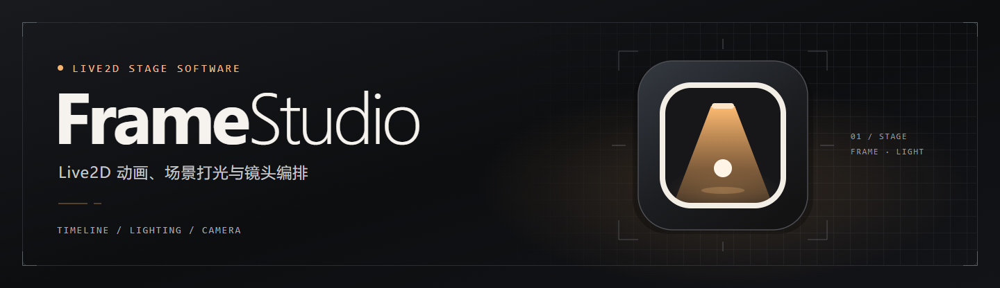
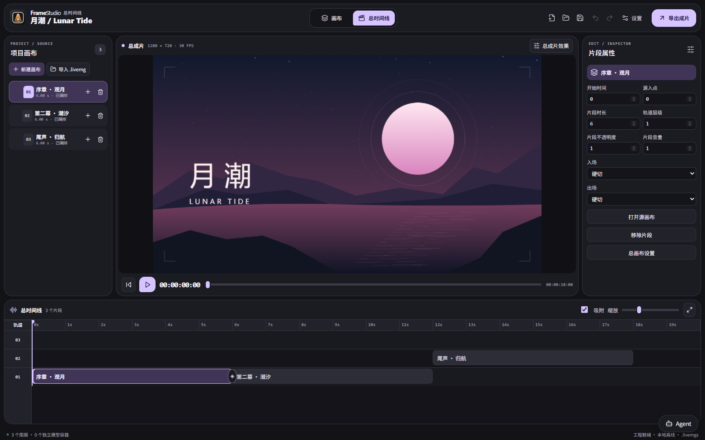
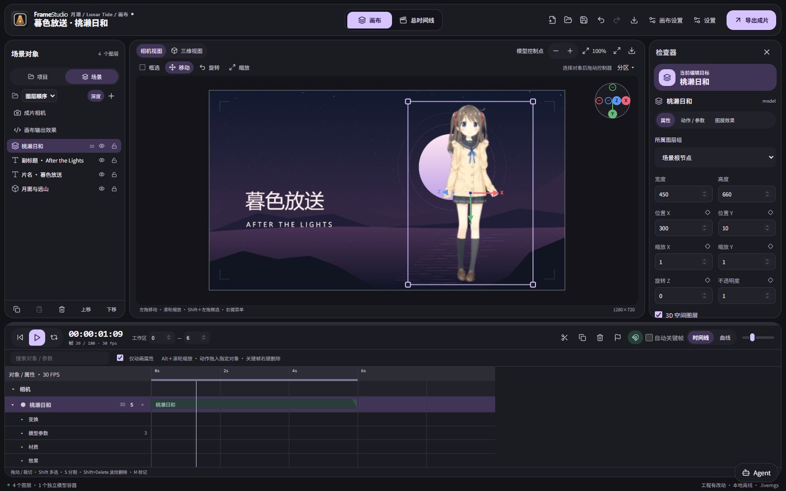
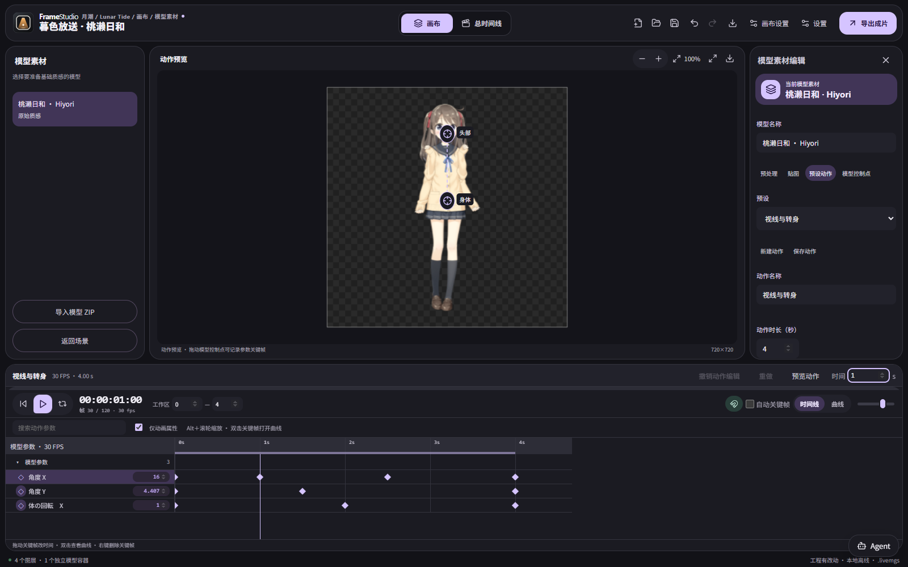
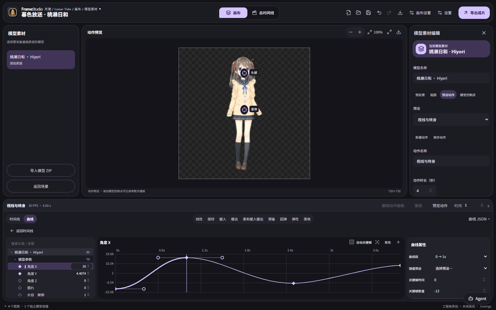
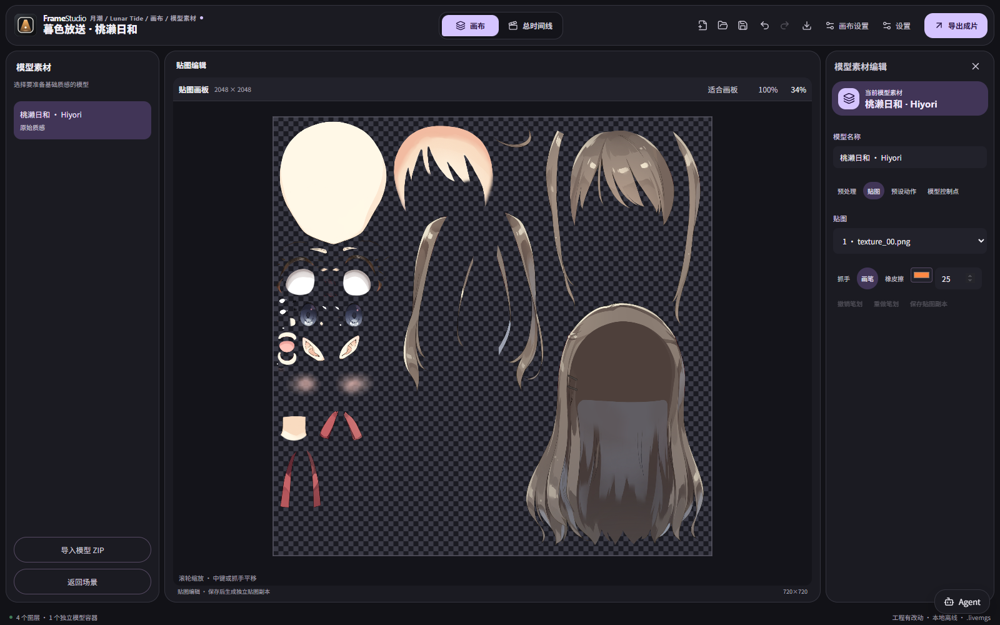
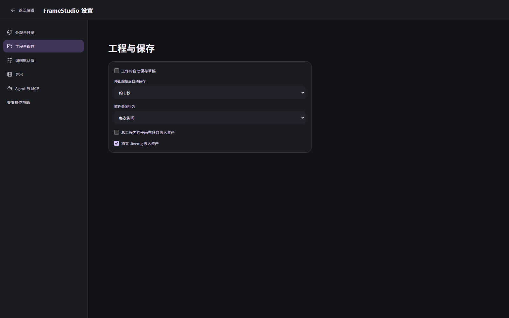
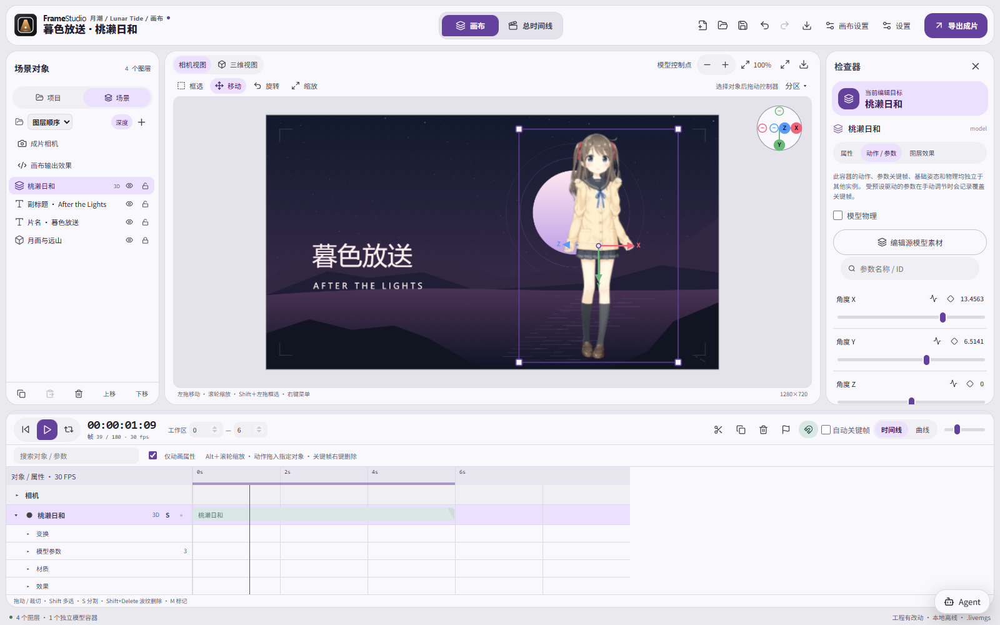
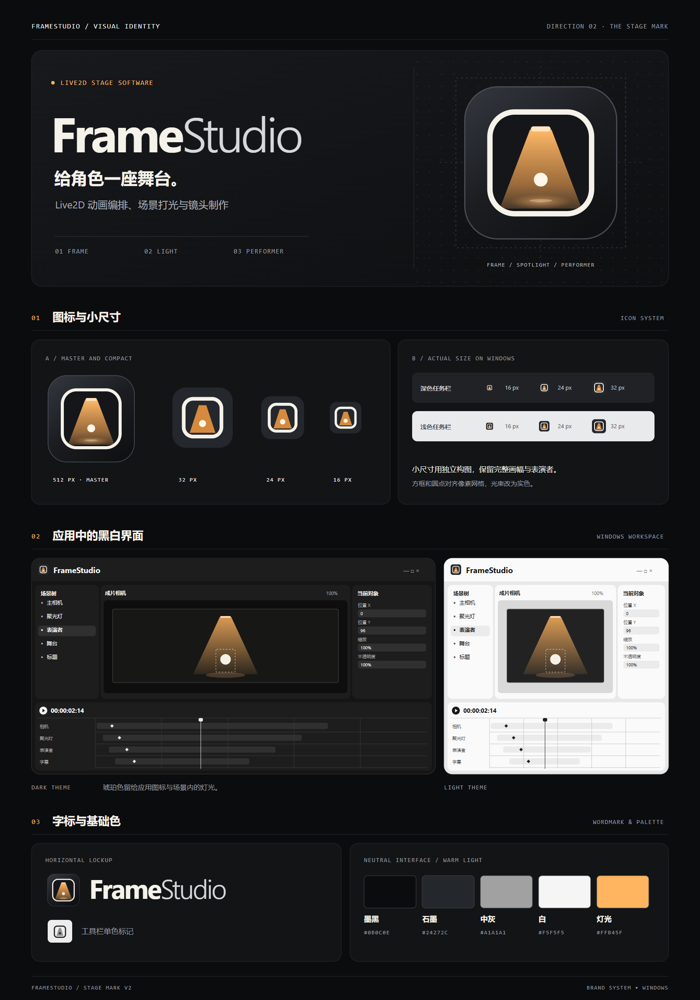

# FrameStudio 2.16.0-preview.3



FrameStudio 是 Windows 上的 Live2D 小剧场编辑器。从独立画布制作角色动画，再通过总时间线编排多个镜头。支持多角色动作叠加、关键帧与贝塞尔曲线、模型贴图和动作编辑、二维与三维预览、场景灯光、离线口型识别及透明视频导出。内置 Agent 与本地 MCP 可以编辑场景、时间线和效果节点。

当前版本为开发预览版。核心编辑、模型预览和渲染可离线运行。

此仓库包含编辑器源码和测试。从源码启动请看下方「开发与验证」。便携版用户解压完整目录后双击 **FrameStudio.exe**，无需安装 Node.js、AE 或 Cubism Editor。移动便携版时请保留整个目录。

公开仓库和便携发行包不附带 Live2D 模型、模型素材或含模型的工程。启动后可在左侧「项目 → 模型」导入你有权使用的模型。

2.7.2 以前的本地演示包可能含有商业模型和角色截图。对外分享请使用全新打包的便携版，轻量补丁会保留旧安装目录中的素材。

## 开源许可证

FrameStudio 原创源码采用 MIT 许可证。第三方组件和演示角色素材适用各自的许可条款。

[MIT 许可证](https://github.com/XKLMY-hi/FrameStudio/blob/main/LICENSE) · [第三方组件说明](https://github.com/XKLMY-hi/FrameStudio/blob/main/THIRD-PARTY-NOTICES.md)

## 实机截图

以下截图由当前 2.16.0-preview.3 构建运行后直接截取。总时间线使用自制的「月潮」场景，模型工作台使用 Live2D 官方免费样本「桃濑日和」。截图生成过程使用独立的临时工作区。

**多画布总时间线**

画布作为独立素材保留，加入总时间线后可编排片段、调整层级并添加接缝转场。



**画布与场景检查器**

项目浏览器管理画布和素材，场景页管理当前画布中的角色、图层、相机与光源。右侧检查器跟随选中对象。



**模型控制点与动作时间线**

控制点绑定已有模型参数。拖动画板中的控制点记录姿势，动作工作台复用主编辑器的时间线与曲线组件。



**贝塞尔曲线编辑**

选择参数后显示该通道的曲线，支持多选、关键帧拖动、控制手柄与缓动预设。



<details>
<summary>查看贴图画板、全屏设置和浅色工作区</summary>

**贴图画板**



**全屏设置**



**浅色工作区**



</details>

本作品的角色在运用株式会社Live2D的著作物素材样本时依据了株式会社Live2D规定的协议。本作品完全根据制作者的自我裁量制作而成。[桃濑日和官方样本](https://www.live2d.com/en/learn/sample/momose-hiyori/) · [素材使用条款](https://www.live2d.com/zh-CHS/learn/sample/model-terms/)

## 当前版本

- **工程导航**分为项目与场景。查看总时间线后，可明确创建总工程；新建和导入画布只加入项目，再由用户将它加入成片。双击片段打开源画布，返回时恢复总时间线的播放头与选中片段。
- **模型工作台**包含素材预处理、中央贴图画板、预设动作和模型控制点。画板支持画笔、橡皮擦、抓手、滚轮缩放、撤销和重做；修改后的贴图保存为副本。
- **动作编辑**复用主编辑器的参数时间线和贝塞尔曲线编辑器，支持新建、重命名、改时长与帧率、记录姿势、编辑关键帧、撤销与重做。保存后写入模型动作库，也可导出标准 `.motion3.json`。
- **模型控制点**可直接放在模型上，为横向和竖向分别绑定参数，并连接控制点。动作工作台里的拖动写入预设动作；场景画布里的拖动只给选中的模型实例写关键帧。控制点的位置与绑定随工程保存。
- **效果范围**明确分为模型素材预处理、图层效果、画布输出与总成片效果。对应入口会直接打开该范围的节点图，已应用的 Agent 节点可以继续查看和编辑。
- **全屏设置**按外观与预览、工程与保存、编辑默认值、导出、Agent 与 MCP 分类。支持新建工程的帧率和时长、自动保存间隔、启动时的吸附和自动关键帧、预览质量、关闭行为、资产嵌入方式与默认导出格式。
- **Agent 与 MCP**可编辑独立画布及总时间线，创建几何图形、文本、场景灯光与 GLSL 节点，操作参数和曲线，分析音频口型并交付预览及文件。对话显示当前编辑范围、工具调用及接口返回的思考内容。

模型控制点驱动模型已有的 Live2D 参数。Cubism 原生网格、变形器与新的模型变形关系需要在 Cubism 源工程中编辑。

## 开始制作

1. 在左侧「项目 → 模型」导入模型 ZIP 或文件夹，在素材卡片上创建角色实例。
2. 在场景中选中角色，在「动作 / 参数」里编辑参数或使用动作库。曲线按钮会定位到当前参数。
3. 进入「编辑源模型素材」，处理素材质感、绘制贴图、编辑预设动作。需要直接摆姿势时，在「模型控制点」中绑定横向和竖向参数，再在「预设动作」中拖动控制点。
4. 制作多个镜头时，打开「总时间线」并创建总工程。导入或新建画布后，点击该画布的「加入总时间线」按钮进行编排，在相接片段的接缝按钮中选用转场。
5. 保存独立画布为 `.livemg`，保存多画布总工程为 `.livemgs`。导出时选择当前画布或完整总时间线。

## 视觉设计

V2 图标将画幅、聚光灯和表演者组合在一起。编辑器延续黑白灰界面，琥珀色用于品牌图标里的光束。Windows 图标包含独立绘制的 16、24 和 32 px 版本。

<details>
<summary>展开 FrameStudio 品牌设计 V2</summary>



[品牌设计 SVG](docs/brand/framestudio-v2.svg) · [仓库头图 SVG](docs/brand/framestudio-banner.svg)

</details>

## 从旧版升级

先保存工程，再关闭程序。完整便携版应放入新目录，然后打开已有的 `.livemg` 或 `.livemgs` 工程。旧 `.l2dstudio` 工程也可打开，再另存为当前格式。跨电脑移动时使用包含资产的工程文件。

使用自行生成的轻量补丁时，将补丁解压到 `FrameStudio.exe` 所在目录。补丁只更新程序文件，原安装目录中的模型、媒体和自动草稿由用户保留。关闭程序后再执行文件替换。

<details>
<summary>展开 2.2–2.15 历史版本记录</summary>

## 2.15.2 总工程与模型工作台

- 同轨片段接齐后，从接缝的加号添加淡入淡出、擦除或滑动。拖动默认吸附片段边缘和播放头，按住 Alt 可临时跳过吸附。
- 总工程保存为 .livemgs。默认由总工程持有共享素材，子 .livemg 只存各自的工程内容。设置可切换嵌入方式，旧总工程仍可打开。
- 「模型编辑」包含预处理、贴图画笔和橡皮擦、预设动作关键帧。修改贴图另存副本，动作保存为 .motion3.json，Agent 也可使用这些功能。
- 「后处理节点」可切换画布、图层、模型预处理与总成片范围。虚线标出待确认的草稿，应用后可按 Ctrl+Z 回到待确认状态。
- 「设置」集中管理外观、预览质量、关闭行为、自动保存、资产打包及 Agent/MCP。

## 2.14.0 总时间线

- 点顶部「总时间线」把当前画布加入总工程。可新建画布、导入现有 .livemg 或把同一画布放入多个片段。双击片段回到独立画布编辑。
- 拖动片段编排时间和轨道。高轨道显示在前，片段可设置入点、时长、透明度、音量，以及淡入淡出、擦除和滑动。重叠时可用上层片段淡入完成交叉转场。
- 总成片可添加独立的后处理节点。预览最长边为 768 像素，优先加载当前可见的源画布，并预热一个即将出现的片段。导出使用选定画布或总时间线的原始规格。
- 保存总工程时，画布及共享素材一起打包为 .livemg。打开源画布后可另存单画布工程，导出对话框也可以在当前画布和完整总时间线之间切换。
- Agent 可通过画布 ID 编辑每个独立画布，在同一份草稿里调整总时间线的顺序、层级、转场和总后处理。

## 2.13.1 画布 Agent 指针

Agent 执行时，指针沿着画布中的对象、灯光或可见变换手柄移动，在等待下一步时停在当前目标。指针跟随预览视角，整轮执行结束后退场。

## 2.13.0 场景 Agent 与交付

- Agent 能读取选中对象、数值属性、曲线段和音频片段。新建场景光源会显示在草稿图层中，可在三维视图定位。Agent 写入 GLSL 后可从画布工具栏的「后处理节点」打开输出链。
- 「添加图层 → 几何图形」支持矩形、椭圆、星形、自定义 SVG 和参数表达式。文本层可直接编辑和导入导出动画 JSON。
- 用 Agent 输入框旁的回形针添加参考图，点缩略图即可画笔标注。视觉模型可接收显式附件。成片预览和交付文件可从对话下载，向模型分享画布截图仍由设置控制。

## 2.12.2 长输出与会话管理

Agent 流式接收按正文、思考和工具参数的实际内容计量。网络仍在返回数据时会继续等待。工具调用和回执完整后才记录为会话检查点。上下文确实超限时，会先整理较早的工具结果，再尝试用较短的历史继续。会话处理参考了 [DeepSeek Harness 架构](https://github.com/deepseek-ai/deepseek-harness/blob/master/docs/architecture.md) 和 [上下文压缩](https://deepseek-harness.github.io/deepseek-harness/en/reference/subsystems/compaction)。

## 2.12.1 Agent 流式输出

Agent 对话可以实时显示正文和模型 API 返回的思考内容。工具调用有独立记录，可以展开查看参数和结果。密钥改用本机配置文件明文保存，首次使用新版时会尝试迁移旧配置。

## 2.12 场景设计 Agent

内置 Agent 可编辑画布、图层、三维布光、镜头、模型、时间线、文字、音频口型和后处理节点。可以跨多个工具调用持续修改同一草稿，画布和时间线实时预览，应用时记录一次撤销。DeepSeek Flash 可在用户开启画面分享后查看成片预览。[使用说明](SHADERS.md#内置-agent)

## 2.11.1 DeepSeek API

内置 Agent 增加 DeepSeek 官方 OpenAI 格式预设、模型选项和深度思考开关，支持带节点工具调用的多轮对话。[配置说明](SHADERS.md#内置-agent)

## 2.11 内置 Agent 与 GLSL 节点

GLSL 着色器可作为独立节点接入图层或成片后处理。内置 Agent 和 MCP 都能读取图、调整连线并试渲染。右下角的 Agent 悬浮窗支持用户自配 OpenAI 兼容 API。已应用的旧版代码着色器在打开工程时可迁移到节点图。[配置与使用说明](SHADERS.md#内置-agent)

## 2.10 成片着色器与 Agent

在画布工具栏打开「代码着色器」。可以对单个图层编写 GLSL，也可以给整个成片调色、泛光或做画面变形。导入后可先试渲染，再应用到工程。已应用的效果同步到成片预览和视频导出，并随 `.livemg` 保存。

通过本地 MCP，Codex 等 Agent 可以根据自然语言生成和修改着色器，实时提交试渲染，并读取编译错误。画面分享可以单独启用。[GLSL 格式与 MCP 配置](SHADERS.md#接入本地-mcp)

## 2.9 效果节点与 JSON 预设

在「场景后处理」「模型预处理」或文字属性中选用节点预设，也可以打开「编辑节点」。拖动输出端口到输入端口连接，选中节点可调整参数、设为输出或查看中间预览。公开的数值参数会出现在属性面板，场景实例的参数可在时间线上打关键帧。

节点图可保存为 JSON，导入后也可作为节点组插入现有配方。整体效果设置另可导入导出，涵盖后处理、素材精修、文字样式和独立光源。曲线编辑器中的「曲线 JSON」可保存完整属性关键帧或选中段的缓动，后者可用于文字的曲线取样节点。[JSON 格式说明](SHADERS.md)

## 2.8 旧版 Live2D 模型兼容

可在同一个场景使用 Cubism 2.1（`model.json` 或 `*.model.json`、`.moc`）与 Cubism 3/4/5（`.model3.json`、`.moc3`）。从左侧「项目 → 模型」导入包含配置、模型与贴图的 ZIP 或文件夹。旧版 `.mtn` 动作、`.exp.json` 表情和物理可用于时间线、参数编辑和输出。

使用旧模型前，在便携目录的 `resources/app/data/runtime/` 放入 Cubism 2.1 Web 运行库 `live2d.min.js`。从源码运行时，路径是项目根目录下的 `data/runtime/live2d.min.js`。首次导入旧模型时按需加载，之后可离线使用。[运行库说明](https://github.com/guansss/pixi-live2d-display/tree/v0.4.0/core#cubism-21)

## 2.7 文字动效、素材精修与着色器

文本新增浮升、冲入、弹力、摆动、反弹、擦入、闪亮、故障残影、漂浮和呼吸。入退场可分别设置时长，效果与时间线同步。

模型预处理新增自适应锐化、曝光、高光柔化、半透明边缘净化和柔光扩散。可选精修预设，并在预处理工作区直接对照原始模型。

画布和图层右键菜单提供「复制对象」「原地粘贴」，也可用 Ctrl+C / Ctrl+V。在同一工程内，复制对象保留位置、父子关系、关键帧和所属片段；时间线片段仍从播放头粘贴。

场景后处理提供赛璐璐墨线、漫画网点、VHS、霓虹、胶片、双色、像素和黑色电影预设。风格强度可以打关键帧。自定义配方随工程保存，参见 [着色器格式与示例](SHADERS.md)。

## 2.6 Tonal Stage 工作区

采用 Material 3 Expressive 风格的黑白工作区。点工程栏的调色板图标，在「外观」中选择系统、浅色或深色主题，再独立选择黑白、湖蓝、鸢尾紫或玫瑰粉强调色。黑白是默认配色，旧版琥珀选项会自动映射到黑白。偏好保存在便携目录，重启后恢复。

左侧可切换素材、图层和场景树。场景树中可展开对象并直接选择其动作或音频片段。时间线显示时、分、秒、帧，曲线工作区提供常用插值预设工具栏。模型预处理列出使用同一素材的实例。导出面板集中显示成片规格、格式与范围。

## 2.5.2 曲线通道树

修正动作及音频片段浮到列表顶部的问题。片段显示在所属对象的分类下，跟随列表滚动并随父级折叠。

## 2.5.1 右键菜单与曲线编辑

修正两个预览区的右键菜单尺寸。菜单使用紧凑宽度，并在窗口边缘向内摆放。

曲线页沿用时间线的对象、片段和属性分类。左侧可展开相机、图层组和各对象的变换、模型参数、材质、效果等，搜索也会展开匹配的层级。属性行显示数值和关键帧状态，未动画化的控件也能编辑。从时间线打开曲线页时，先在左侧选择属性；从某个关键帧或音量入口打开时，会直接定位对应通道。Ctrl/Shift 点击或框选可以同时显示多条曲线。

曲线几何按可见时间范围合并绘制，播放时复用几何；隐藏的时间线保留折叠和滚动状态，暂停重建行。拖关键帧只更新当前关键帧的预览，松手后提交。

## 2.5 分区预览、框选和曲线

画布工具栏“分区”可左右或上下拆分，拖分隔条改变比例。两个预览区可分别选择成片或三维视角，共享场景、选中对象和播放头；点第二预览的 × 恢复单区。时间线上按 Alt + 滚轮，以鼠标所在时间为中心缩放。

三维预览用中键环绕，左拖移动对象，左拖空白处平移；Shift + 中键也可平移。两个视图都可右键隐藏、锁定、删除或进入模型预处理。按 Shift + 左拖或开启“框选”选中多个对象；拖动控制器可一起变换，旋转、缩放以所选对象的空间中点为中心。启用空间遮挡时，被实体遮住的手柄部分隐藏并停止接收点击。

时间线工具栏“关键帧”切到全宽曲线区。左侧点击一个通道只看它的曲线；拖框或 Ctrl/Shift 单击同时查看多条。点击曲线段，右侧可应用保持、缓入缓出、强调、预备、越界回弹、弹性、落地反弹等 13 个预设。也可移动关键帧、拖贝塞尔手柄或双击图表添加关键帧。关闭曲线区会回到原时间线。

选音频片段进入“音量包络”曲线：同一张图显示波形、音量关键帧、渐变包络和淡入淡出控制点；右侧可输入精确时长和渐变形状。口型识别仍在音频属性里。

## 2.4 视图控制、场景遮挡与界面

应用统一名为 **FrameStudio**。右上“外观”可选浅色、深色或跟随系统，设置保存在便携目录内。左侧“图层 / 资产”共用一个区域：图层页包含场景集合、可折叠图层组、相机和可见性/锁定控制；资产页可搜索模型、动作、图像、音频及字体，模型条目显示使用此素材的实例数。

成片和三维视图都可用“移动 / 旋转 / 缩放”控制器。拖动彩色轴手柄编辑对应轴，拖动放大的角点热区等比缩放。启用自动关键帧或已有动画时，拖动记录到当前对象；一次拖动可用一次撤销恢复。右上 XYZ 方位指示器随视角转动，点击轴端可切换查看方向。视角、指示器和控制器不写入成片。

新建模型默认进入三维空间。相机 Z 越大，越靠近空间对象，越过相机近平面的部分不再显示。原工程的二维模型仍固定在屏幕上；在“成片相机”面板点击“让模型跟随相机”，即可将未锁定的二维模型切换为三维。二维字幕和浮层不受这项操作影响。

场景集合旁的“深度”控制全场三维遮挡，关闭后恢复按图层叠放。单个三维图层或图层组也可开启“忽略遮挡，按图层叠放”。常规三维平面按真实交线分段合成，保留透明度；没有独立后处理的组可参与同一深度合成。二维浮层、强制叠放、特殊混合和独立后处理保留自己的合成边界。该设置同时作用于成片预览和导出，随工程保存。

## 2.3 三维预览与动作试听

在画布顶部切换“成片 / 三维预览”，或按 V。三维视图跟随时间线，显示模型平面、灯光、地面网格和成片相机范围。中键拖动环绕，Shift + 中键拖动平移，滚轮推拉；左键拖动对象，拖空白处平移。可快速切换透视、正视、侧视和俯视，按 F 聚焦选中对象，Shift + F 适配全场。点击右上“放大预览”放大画布，Esc 还原。Live2D 仍是平面，从侧面看会变薄。查看方向、网格和预览放大不写入工程，也不改变成片相机、截图或导出。

在动作库选中预设，画布下方会出现试听控制条，可暂停、从头播放、逐帧、拖动进度、循环和调速。试听只播放所选预设并保留末帧，原时间线的动作和关键帧不会参与；预设的淡入淡出仍保留在素材中，添加到时间线后照常生效。隐藏或当前时刻不在画面的模型会进入独立试听，时间线位置和图层可见性保持原样。试听时空格暂停／继续、左右方向键逐帧，Esc 或控制条右侧 × 结束试听。

## 2.2 场景光源与模型预处理

从图层区“＋”创建点光源、面光源、日光或环境光。光源是没有可见实体的独立场景组件，可命名、分组、复制、隐藏和设置时间范围；画布中的灯光图标、面光边框及方向线仅用于编辑，不会导出。可在画布拖动位置，在属性区修改 Z 深度、三轴旋转和面光尺寸；方向跟随旋转，距离和范围影响衰减。最多 16 盏灯同时参与场景照明。

同一盏灯可同时影响多个模型，默认影响全部接收光照的对象；在光源属性选择指定模型、图片或图层组可限定范围。模型默认接收场景光，其他图层需手动开启。每个模型实例在“场景后处理”中可以关闭接收光照，或调整粗糙度、高光、轮廓光和轮廓起伏。场景环境光和曝光在光源属性中统一控制。光源的强度、范围、衰减、面积、高光与轮廓光，以及位置和旋转，均支持独立关键帧；材质数值也可动画化。

顶部“模型预处理”进入独立工作台，左侧选择模型素材，右侧提前处理亮度、对比度、饱和度、泛光、边缘发光、描边和模糊；可关闭预处理对比原始效果。此处采用中性姿态，不受场景光源、动作、实例后处理和调整层影响。预处理按素材保存，同一素材的多个实例共享；场景里每个模型实例的“场景后处理”仍然独立。原模型文件不会被改写，设置保存在草稿和 `.livemg` 中。点击“返回场景”或 Esc 回到场景。

渲染顺序为：**模型素材预处理 → 共享场景光照 → 实例场景后处理 → 图层组 / 后处理层**。旧工程原有的轮廓点光、面光和日光模拟效果继续保留在后处理里，与新场景灯光分开；需要统一布光时可关闭旧的局部模拟，改用场景组件。场景中没有灯光时保留原来的外观。

空间照明计算使用模型平面在三维场景中的位置、朝向与光源距离，并提供轮廓起伏近似；Live2D 本身仍是 2.5D 平面，不提供角色间投影、真实体积法线或网格自阴影。

本版保留 2.1.1 的多模型内存修复：添加较大模型时同步底层内存扩容后的参数、部件与网格视图，防止旧角色动作、预览和导出冻结。

</details>

## 场景与图层

- 输出画框周围可继续摆放内容；滚轮以鼠标位置缩放工作视图，中键拖动画布。视图缩放不改变导出构图。导出只取画框内的内容。
- 支持多个 Live2D 模型、图片、文本、纯色、图层组、后处理层和音频节点。可命名、排序、分组、隐藏、锁定、复制整个组和设置混合模式。组的变换与透明度影响子层。
- 每个模型容器拥有独立参数、基础姿态、动作、物理和口型绑定。同源模型可以创建多个实例；共用一个 WebGL 上下文，控制器和物理状态独立。
- 开启“3D 空间图层”后可调 Z、X/Y/Z 旋转；相机支持位置、缩放、焦距、焦点深度和景深强度关键帧。2D 文本等浮层可固定在屏幕上。
- 三维功能采用 **有透视和深度的 2.5D 平面**：模型、图片和文字作为平面放入空间，景深按平面深度模糊。不包含 3D 网格导入、体积照明或真实法线自阴影。三维平面按深度与交线合成，二维和强制叠放图层保持列表顺序。

## 素材和时间线

左侧项目浏览器可导入模型 ZIP / 文件夹、`.motion3.json` / `.exp3.json` / 旧 `.mtn` 动作、PNG/JPEG/WebP/SVG 图片、音频和 TTF/OTF 字体。模型需包含 `.model3.json`、`.moc3` 和贴图；CMO3 需要先导出运行时模型。SVG 作为静态图片加载。暂不支持视频素材轨。

时间线以对象组织，按图层组父子级折叠。每个对象下分别展开动作/表情、变换、模型参数、音频与效果。每项参数的关键帧独立成行；可拖动改时间、右键删除，也可在曲线面板精调。属性绑定包含对象 ID，切换对象不会把关键帧写到另一个模型。点击左侧图层名称或时间线对象名称都会选中该对象。

时间线支持对象/参数搜索、“仅动画属性”筛选、拖动顶部边缘调整高度，以及片段多选、移动、裁切、分割、复制、变速、循环、吸附、独奏、锁定、标记与工作区循环。对象和片段均可自由命名。旧工程的通用轨道数据会保留并按对象显示。动作时长仍按元数据的原始秒数读取。

动作库有明确的目标对象下拉框。单击动作卡片即可在画布试听动作，播放结束时停在末帧，点击停止恢复场景；预览不会新增片段、改变关键帧或进入工程。点击卡片的 ＋ 或双击才会加入该对象的时间线；也可将动作拖到指定模型对象上。

重叠动作可使用归一化混合、增量或覆盖。每个片段可单独屏蔽参数组或单个参数。旧模型命名不一致时需要检查参数映射。修改预设曲线时会创建独立副本，不影响使用同一素材的其他片段。

属性旁菱形记录关键帧；开启自动关键帧后，修改属性会记录当前时刻。已存在动画的属性再次修改会更新当前关键帧。模型参数受预设或口型驱动时，手动调节会为当前对象记录覆盖关键帧，避免被动画覆盖；未受动画驱动的参数仍可修改基础姿态。曲线支持线性、贝塞尔、阶跃和反向阶跃，并可调整控制手柄。模型参数、图层变换、效果、相机和音量均可动画化。曲线和属性面板可点 × 或 Esc 关闭。模型动作工作台中的动作与场景时间线分别保存；离开工作台前请使用「保存动作」或「保存贴图副本」，未保存修改会在离开时提示。

## 音频、文本和后处理

- 音频库支持直接播放、波形和拖动试听进度。预览不向时间线插入片段。音频编辑器显示波形，可拖动淡入/淡出控制点，设置线性或等功率渐变、片段音量、变速、循环和音量关键帧。视频导出会混音并应用音量包络。
- 背景音乐和配音都作为普通音频导入，默认不识别、不绑定口型。选中配音片段后，在属性区点击“识别口型（仅此音频）”，然后手动选择绑定模型。选择模型不会自动启动识别。音量与口型幅度独立。内置 Rhubarb Lip Sync 1.14.0 Phonetic 离线识别；失败时回退为音量口型。通用识别并非中文逐字强制对齐。模型嘴部参数特殊时，需要检查控制器参数。Rhubarb 对 Unicode 可执行路径存在兼容限制，首次运行会将引擎缓存到系统临时目录的 ASCII 路径，任务临时音频完成后清理。
- 文本支持字体、字号、颜色、描边、对齐、打字机和淡入淡出。动画跟随片段源时间。导入字体随工程打包；只填写系统字体名称时，目标电脑需具备该字体。请只嵌入有使用和分发权限的字体。
- 普通图层的效果只处理自身；**后处理层作用于同组中位于其下方的合成结果**，上方图层不受影响。支持描边、边缘发光、泛光、亮度/对比度/饱和度、模糊，以及基于透明轮廓的点光/面光/日光模拟、轮廓光和光泽。数值效果可记录关键帧。
- 模糊提供高质量可分离高斯和镜头散景。高斯使用较大卷积核与多遍处理；镜头散景按圆形光圈采样，支持高光权重，预览 32 点、导出 64 点，并按预乘 Alpha 计算，避免透明轮廓出现黑边。景深可单独选择算法。景深仍按每张 2.5D 平面的深度计算，不是逐像素 3D 深度缓冲。

## 工程和导出

`.livemg` 是独立 ZIP 工程，包含版本清单、场景 JSON、缩略图、模型文件、动作、媒体、导入字体、各实例控制器和动画。同源模型仅打包一次；各文件带 SHA-256 校验。重开时资源分配独立路径，避免覆盖其他工程。保存使用原生文件对话框。

自动草稿位于 `resources/app/data/autosave-scene.json`。自动草稿记录编辑状态；跨电脑移动请使用带资产的 `.livemg` 或 `.livemgs` 工程。

导出 **MP4 H.264 / AAC**、**MP4 H.265 / HEVC / AAC**、**GIF 动图**、透明 **WebM VP9**、**MOV ProRes 4444** 和 **PNG 序列 ZIP**，可选整段或工作区。MP4 适合常用播放器和发布；H.265 需要播放器支持 HEVC。MP4/GIF 可选择透明区域填充色，MP4 奇数尺寸会向上补齐到偶数。视频包含混音，GIF 与 PNG 序列不含音频。背景图或纯色层会遮住透明区域，需要透明时隐藏这些层。部分播放器显示黑底，实际视频仍带 Alpha。导出使用原始尺寸和帧率，不受预览清晰度影响；中间 PNG 会占用磁盘空间。

快捷键：空格播放/暂停；←/→逐帧；Home/End；S 分割；M 标记；Delete 删除；Shift+Delete 波纹删除；Ctrl+D 复制；Ctrl+C/V 复制粘贴片段；Ctrl+Z / Ctrl+Shift+Z 撤销/重做；Ctrl+S 保存；Esc 关闭面板。

## 性能与范围

默认低分辨率预览，播放上限 30 FPS；暂停时不持续渲染。物理使用固定 60 Hz 步长和状态缓存。可降低预览清晰度、减少可见角色或关闭景深/泛光以减轻负担。多角色、滤镜和大图会增加开销，实际帧率取决于模型与硬件，不能保证所有场景满帧。

暂不包含模型拆件、视频素材轨、音频降噪/频谱编辑、3D 网格、逐字字幕或真实三维法线照明。

## 开发与验证

在 Windows 上使用 Node.js 22.12 或更高版本。运行前，将 Live2D Cubism Core for Web 的 `live2dcubismcore.min.js` 放到 `public/vendor/`，供模型预览使用。通过编辑器导入自己的模型即可开始编辑。

```powershell
npm ci
npm run build
npm test
npm start
```

如需视频导出，将 FFmpeg 放到 `tools/ffmpeg.exe`。如需离线口型识别，将 Rhubarb Lip Sync 1.14.0 的 Windows 发行目录（含资源）解压到 `tools/rhubarb/`。便携打包使用本地工具，含模型的界面验收使用本地素材。组件及来源见 [第三方组件说明](THIRD-PARTY-NOTICES.md)。

构建后运行 `npm run package`，在 `release/FrameStudio-版本号-portable/` 生成新的便携目录。打包脚本会拒绝覆盖已有版本目录。

需要生成归档和轻量补丁时，运行 `python scripts/archive-portable.py --baseline 已安装版本号`，并确保 `release/` 下存在对应版本的基线便携目录。归档脚本会检查本地数据、模型文件、工程文件和旧版预览图。发布归档应从新打包的目录制作。

单元测试覆盖动作引擎、场景变换、显式对象绑定、Agent 响应和工具调用、效果节点、曲线文件与工程格式。UI/导出测试在独立 QA 副本运行。

`node --import tsx scripts/montage-qa.mjs` 验证画布导入、显式加入总时间线、吸附、层级、转场、Agent 跨画布草稿及导出。`node --import tsx scripts/workbench-qa.mjs` 使用本地测试模型验证模型工作台。

要重拍 README 截图，先运行 `npm run build`，再运行 `node --import tsx scripts/capture-readme.mjs 本地Hiyori.zip路径`。脚本在独立的临时工作区导入模型，仅将 PNG 截图写入 `docs/screenshots/`。Windows 默认使用本机 Edge，也可通过 `STUDIO_BROWSER_EXECUTABLE` 指定 Chromium 浏览器路径。

`node --import tsx scripts/shader-mcp-qa.mjs` 使用纯色图层和本机模拟提供商验证 GLSL 连线、MCP、密钥迁移、流式工具调用、普通响应回退、透明导出和工程重开。

`node --import tsx scripts/agent-live-qa.mjs "<现有安装的 resources/app/data/browser-profile>"` 使用当前 Windows 账户已配置的 DeepSeek 密钥做实际调用。测试只发送独立的合成工程与其预览帧，会产生 API 用量。

`node scripts/v21-qa.mjs` 覆盖名称选中、双模型独立编辑、参数分行/拖动、无损动作预览、BGM 不触发识别、显式口型识别，以及实际 MP4/H.265/GIF/WebM 编码；`node --import tsx scripts/blur-v21-qa.mjs` 检查模糊透明边缘、采样质量、工程重开及播放性能。测试需要本地 QA 示例、工具与音频，不随运行时分发。

`node --import tsx scripts/lighting-v22-qa.mjs` 验证多灯真实 GPU 像素、三维距离及旋转、接收范围、同源实例共享预处理、独立后处理、暂停零重绘、双模型动作、工程重开与实际透明视频导出。

`npm run qa` 验证菜单边界、曲线对象与分类、数值与关键帧、单选和框选、音频包络，并用两位模型和 1,440 个关键帧检查密集曲线播放。

本地服务监听 127.0.0.1，使用随机会话密钥和同源检查。内置 Agent 连接用户配置的 API，显式参考图和用户开启的画面分享可以随请求发送。当前 API 密钥按本机配置保存，配置文件应留在个人设备上。第三方组件及许可见 [第三方组件说明](THIRD-PARTY-NOTICES.md)。
